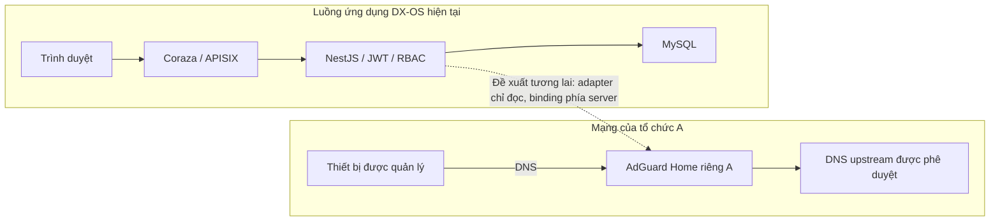

# Đánh giá tích hợp AdGuard vào DX-OS

Ngày đánh giá: 21/10/2026. Trạng thái: **chấp nhận thiết kế cho PoC riêng; chưa chấp nhận triển khai production hoặc mở dữ liệu DNS cho tenant**.

## 1. Yêu cầu và phạm vi đã thực hiện

Đối chiếu yêu cầu bổ sung quét bảo mật, tài liệu hạ tầng và đánh giá khả năng ghép AdGuard. Đã đọc toàn bộ tài liệu kỹ thuật 14 trang do nhóm cung cấp và đối chiếu repository, API, giấy phép và hướng dẫn chính thức của AdGuard Home. Tài liệu tham chiếu được phân loại nội bộ: không đưa PDF, địa chỉ mạng, MAC, danh bạ thiết bị, nhật ký, số liệu vận hành hay URL báo cáo của đơn vị cung cấp lên repository public.

Lượt này hoàn thiện **đánh giá và thiết kế**, đúng phạm vi hạ tầng bằng tài liệu. Không cài DNS/service, thay router/firewall/DHCP hoặc đưa AdGuard thành dependency của demo v0.1.0. Không bổ sung endpoint, permission, bảng dữ liệu hay migration. Các kiểm thử AdGuard live trong [kế hoạch nghiệm thu](adguard-validation-plan.md) chưa được thực thi.

Ngoài phần AdGuard, lượt quét ngày 21/10 phát hiện CVE-2026-111755/CVE-2026-111756 ở follow-redirects 1.16.0 trong frontend lockfile. Kế hoạch vá: cập nhật riêng transitive dependency lên 1.16.1 trong range Axios đang dùng, không sửa UI/API; chạy lại regression và security gates. Xem [ghi nhận bản vá](../security/follow-redirects-2026-10-21.md). Không bỏ qua cảnh báo để giữ PR chỉ có tài liệu.

## 2. Lựa chọn thành phần

Chọn **AdGuard Home** để đánh giá: dịch vụ lọc DNS có API quản trị. Không đồng nhất nó với mọi repository của AdGuardTeam, extension trình duyệt hoặc dịch vụ DNS thương mại. Phiên bản tham chiếu trong tài liệu nhóm là v0.107.78; GitHub API chính thức trả latest stable **v0.107.79** lúc kiểm tra 21/10/2026. Đây là ứng viên đánh giá, **không phải phiên bản đã được DX-OS duyệt bảo mật**. Khi triển khai phải chốt lại version, commit, checksum/signature và image digest; không dùng latest/beta/edge.

Các phát hiện được phân biệt như sau:

| Nội dung | Kết quả | Căn cứ |
| --- | --- | --- |
| Lọc DNS và quan sát truy vấn có thể bổ sung lớp bảo vệ mạng | Phù hợp về chức năng | Tài liệu nhóm; README upstream |
| Đưa số liệu DNS vào báo cáo tổng hợp có kiểm soát | Khả thi theo thiết kế | API `/control/status`, `/control/stats`, `/control/querylog` |
| Dùng DNS để đo byte, giới hạn tốc độ hay kết luận hiệu suất nhân viên | Không phù hợp | DNS query count không phải byte hoặc thời gian sử dụng |
| Suy ra nhân viên chỉ từ IP/MAC | Không chấp nhận | DHCP, NAT, proxy, MAC ngẫu nhiên và thiết bị dùng chung |
| Expose chung một AdGuard admin/API cho nhiều tenant | Không chấp nhận | API quản trị và thống kê có phạm vi instance |
| Bật ngay trên mạng thật | Chưa đủ điều kiện | Chưa có quyền vận hành mạng, kiểm thử tenant, restore hay scan ứng viên |

## 3. Ranh giới với kiến trúc hiện tại

DX-OS giữ NestJS modular monolith, MySQL 8.0.44 và Prisma 6.19.3. JWT/session, ACTIVE membership và permission catalog hiện tại tiếp tục quyết định quyền nghiệp vụ. Keycloak xác thực danh tính; APISIX/Coraza bảo vệ HTTP; ClamAV quét file; OpenBao giữ secret; Valkey hỗ trợ shared rate limit. AdGuard là lớp **DNS**, không thay thế các thành phần trên.

Mũi tên nét đứt là **thiết kế tương lai**, chưa có adapter hoặc kết nối runtime trong bản này. Bộ demo source v0.1.0 vẫn hoạt động độc lập với AdGuard.

## 4. Ràng buộc tenant và định danh

Phương án đầu tiên là một AdGuard instance/volume/credential/network riêng cho mỗi tổ chức được tích hợp. Registry phía server gắn organization với đúng instance; client không được gửi URL upstream, credential, instance ID hoặc danh sách tenant để chọn nguồn dữ liệu. Registry và adapter chưa được triển khai.

Nếu phát triển API DX-OS sau này: dùng JWT actor, ACTIVE user/organization/membership và AuthorizationService/OrganizationPermissionGuard hiện có. Đề xuất quyền mới `network-security:read` cần PR catalog/contract riêng và provisioning tường minh; **hiện chưa tồn tại, chưa được cấp**, không suy từ tên admin hoặc quyền role:read. Không dùng AdGuard Basic Auth làm quyền thành viên DX-OS.

Không lấy `/stats` toàn instance rồi đổi organizationId ở JSON để gọi là tenant isolation. Không công khai `/querylog`, top clients, địa chỉ quản trị hoặc credential cho frontend. Thiết kế nhiều tenant chung instance chỉ được xem xét lại khi có cơ chế phân vùng và bằng chứng kiểm thử độc lập.

Định danh thiết bị cần binding có thời gian hiệu lực, do người có quyền xác nhận và thuộc cùng tổ chức. Thiếu binding hoặc có NAT/proxy: ghi **chưa xác định / nguồn tổng hợp**, không gán một nhân viên. MAC không được coi là thông tin định danh luôn có trong DNS query. Không tự cập nhật attendance, performance, payroll hay hồ sơ nhân sự từ dữ liệu DNS.

## 5. Các bài học áp dụng từ tài liệu nhóm

- Giữ allowlist phục vụ nghiệp vụ và kiểm tra xung đột với blocklist; tránh chặn nhầm CDN/dịch vụ dùng chung.
- Lịch dịch vụ phải thử cả giờ mở và giờ đóng; không giả định lịch riêng cho từng nhóm nếu cấu hình đang dùng một lịch chung.
- DHCP/proxy/NAT ảnh hưởng khả năng nhìn thấy IP nguồn; sửa topology cần người quản trị mạng, không phải sửa frontend.
- DNS cache và kết nối đang mở có thể làm kết quả thử khác mong đợi. DNS bypass, IP trực tiếp, IPv6, DoH/DoT/DoQ và mạng di động cần phân tích riêng.
- Không sao chép ratelimit=0, allowlist, rule hay việc tắt Safe Browsing/DNSSEC từ mạng tham chiếu sang DX-OS. Đo tải, đường truyền và đánh giá từng trường hợp.
- Truy vấn DNS chỉ là tín hiệu kỹ thuật. Một truy vấn tới domain game/VPN không đủ chứng minh hành vi cố tình vi phạm hay máy đã nhiễm mã độc.

## 6. Quyết định và điều kiện đi tiếp

**GO cho thiết kế/PoC trên máy riêng với dữ liệu giả**, chưa mở UI quản trị mới. **NO-GO cho production và tenant API** cho đến khi các điều kiện sau có bằng chứng: artifact ứng viên được xác minh và quét HIGH/CRITICAL; kiểm thử DNS và quyền/tenant; schema response chỉ chứa aggregate cần thiết; hạn lưu/xóa dữ liệu được phê duyệt; backup/restore diễn tập; xử lý upstream outage và bypass được kiểm chứng; vận hành mạng chấp thuận thay đổi.

Xem [runbook hạ tầng](adguard-infrastructure-runbook.md), [security review](adguard-security-review.md), [test plan](adguard-validation-plan.md) và [bàn giao công việc](../team/adguard-work-plan.md). Không chỉnh tag/asset v0.1.0 đã phát hành; thay đổi triển khai tương lai đi qua nhánh/PR và release mới theo [quy trình phát hành](release-process.md).

## Nguồn công khai đã đối chiếu

- [Repository và mô tả API](https://github.com/AdguardTeam/AdGuardHome).
- [Release v0.107.79](https://github.com/AdguardTeam/AdGuardHome/releases/tag/v0.107.79).
- [OpenAPI đúng tag v0.107.79](https://github.com/AdguardTeam/AdGuardHome/blob/v0.107.79/openapi/openapi.yaml): phạm vi `/control`, Basic Auth và operation theo instance.
- [Docker hiện hành](https://adguard-dns.io/kb/adguard-home/docker/) và [hướng dẫn bảo vệ/kiểm chứng release](https://adguard-dns.io/kb/adguard-home/running-securely/). Wiki Docker cũ tự ghi outdated, nên không lấy nó làm hướng dẫn triển khai chính.
- [Giấy phép upstream](https://github.com/AdguardTeam/AdGuardHome/blob/v0.107.79/LICENSE.txt): GPL v3. Giữ attribution/license/source provenance riêng khi phân phối hoặc sửa thành phần này; không đổi nhãn AdGuard thành Apache-2.0 của DX-OS. Repository hiện chỉ có thiết kế, chưa chứa source/binary AdGuard. Cách đóng gói bản phân phối tương lai cần được rà nghĩa vụ giấy phép trước khi phát hành.
