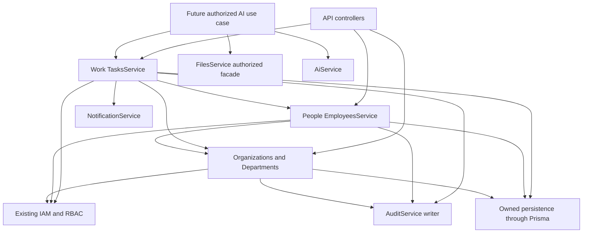
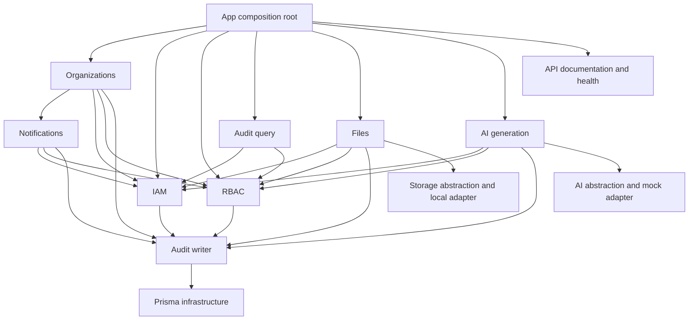
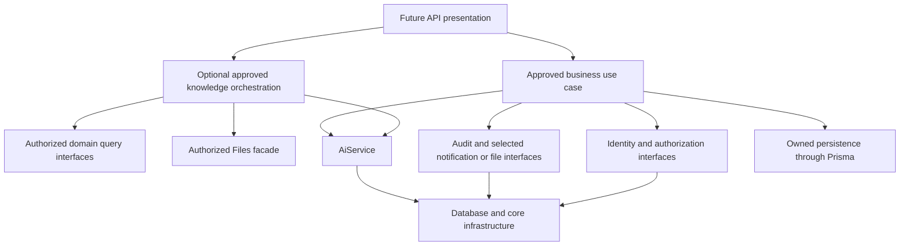

# DX-OS domain architecture — DXOS-DOMAIN-001

> DXOS-DOMAIN-005 implementation update: WorkModule now implements Task CRUD with actor-derived creatorEmployeeId, same-tenant eligible assignee/Department validation, separate task:assign, terminal DONE/CANCELLED states and atomic audit/assignment notification. This explicitly supersedes planned createdByMembershipId and future-Task statements below. [Implementation review](task-v1-implementation.md) and [actual contract](../../contracts/api/tasks/README.md) govern current behavior. No Project/workflow/AI/attachment infrastructure was added.

> DXOS-DOMAIN-004 implementation update: PeopleModule now implements Employee CRUD. The explicit brief revises the prior design to userId + immutable employeeCode, with optional jobTitle/phone. Membership remains authoritative through the same-tenant composite FK; Employee creates no identity/access records. Narrow transactional Organization/Department validators preserve ownership. See [Employee implementation review](employee-v1-implementation.md) and [actual contract](../../contracts/api/employees/README.md). This supersedes Employee schema-only/future statements below; Task remains unimplemented.

> DXOS-DOMAIN-003 implementation update: DepartmentsModule now implements the four flat Department APIs, with explicit RBAC, transactional audit and additive description/status migration. This supersedes schema-only/future-Department statements below; Employee and Work remain design-only. See [Department implementation review](department-v1-implementation.md) and [actual contract](../../contracts/api/departments/README.md). The explicit implementation brief requested a module rather than the previously suggested placement inside OrganizationsModule; ownership and dependency direction are unchanged.

> **Current product decision: DXOS-DOMAIN-002, 2026-09-09.** The final product scope is Organization/Department, People/Employee and Work Management, supported by existing Notifications, Files and AI. The DOMAIN-002 design below supersedes DOMAIN-001 statements that business-domain selection is unresolved. Sections 1–18 remain the historical source-discovery baseline; their implementation findings still apply. The new contract is design-only, not an assertion that these APIs/models exist.

## DXOS-DOMAIN-002: finalized first product slice

“DX-OS là nền tảng điều hành doanh nghiệp số mã nguồn mở, giúp doanh nghiệp quản lý tổ chức, phòng ban, nhân sự, công việc, tài liệu và sử dụng AI như một trợ lý điều hành.”

### Domain ownership and public boundaries

| Domain | Responsibility / owned data | Public service and API responsibility | Tenant / authorization | Dependencies and explicit non-ownership |
| --- | --- | --- | --- | --- |
| Organization | Existing tenant lifecycle, membership relation and discovery | Existing OrganizationsService and organization APIs; export a narrow authorized membership/tenant lookup for approved consumers | Tenant root; existing bootstrap and organization:read/update rules | IAM, RBAC, Audit, Notifications. Does not own employee profiles, tasks or credentials; existing RBAC bootstrap writes remain a documented exception. |
| Department | Flat named structural units; existing Department plus proposed description/status | DepartmentsService within Organizations module: list/create/get/update and validate same-tenant active reference | Organization-owned; department:read/create/update | Organization/RBAC/Audit and own Prisma rows. No employee mutation, hierarchy editing, cost centres, managers or access inheritance. |
| People | Professional Employee profile linked to an existing membership; optional department | PeopleModule/EmployeesService list/create/get/update; narrow eligible-assignee lookup returning only necessary IDs/state | Organization-owned; employee:read/create/update | Authorized Organization membership and Department interfaces, RBAC/Audit, own Prisma rows. No passwords, login, grants, membership provisioning, payroll or sensitive HR dossier. |
| Work | Task lifecycle, creator provenance, assignment and optional department | WorkModule/TasksService list/create/get/update; orchestrates assignment and safe notification intent | Organization-owned; task:read/create/update/assign with field-level permission checks | People/Department public validation, RBAC/Audit/Notifications and own Prisma rows. No employee edits, storage internals, project/workflow engine or AI authority. |

Public interfaces accept server-verified actor/tenant context; no raw unrestricted Prisma clients or model payloads cross the domain boundary. For atomic reference/state checks, expose narrow transaction-aware validation capabilities implemented by the owner. The caller does not take over the owner's tables. Concurrency must serialize deactivation against reference creation/assignment; future tests must demonstrate this rather than relying on an earlier HTTP guard check.

### Final V1 decisions and logical data design

User remains global IAM identity. OrganizationMembership is authoritative for tenant participation. One membership has zero or one Employee; Employee has one immutable membership and zero or one Department. A User can have separate profiles through memberships in several organizations. Employee ACTIVE/INACTIVE represents profile availability, never an access grant/revocation. V1 deliberately excludes employees without existing accounts/memberships. DisplayName is a tenant professional label, not duplicated credentials or a global User update.

Department V1 is flat with immutable normalized code, name, nullable description and ACTIVE/INACTIVE status. Inactivation is useful for retiring units without deleting referenced history. Existing parentDepartmentId is preserved but not exposed for mutation or used for authority; no tree APIs. Existing hierarchical rows are presented as flat units. No normalization/backfill may discard existing parent relations or silently rewrite legacy codes; inspect such data before an implementation migration.

Task has UUID identity, organization, server-derived creator membership, optional employee assignee, optional department, title, nullable description, TODO/IN_PROGRESS/DONE/CANCELLED, LOW/MEDIUM/HIGH/URGENT, nullable UTC dueAt, createdAt/updatedAt. Defaults TODO/MEDIUM; DONE/CANCELLED are terminal. Assignee and department need not match each other, but both must belong to the task organization. Due date is a timestamp; overdue is computed, not persisted as a workflow state. No delete/reopen, projects or attachment tables in V1.

These are logical specifications, not schema changes. Future implementation needs Employee and Task models and additive Department description/status fields. Proposed constraints: Employee unique (organizationId,membershipId), unique (organizationId,id), composite membership/department FKs; Task unique (organizationId,id), composite creator-membership/assignee-employee/department FKs. Retain history with restrictive deletes, no cascade across owners. Tenant-root relations must be enforced, not merely route-validated. Use tenant/id pagination indexes and add only indexes supporting the specified status/department/assignee filters after examining query plans. No generic entities, event/outbox tables or speculative search infrastructure. MySQL 8.0.44 and Prisma 6.19.3 remain unchanged.

The existing schema is adequate for discovery; missing business models are expected future work, not an unavoidable current-schema defect. No migration or historical migration edit is authorized here. A subsequent implementation must review legacy Department values and active-state backfill, foreign-key compatibility, restrictive deletion, indexes, migration/rollback and existing-data tests before applying an additive migration.

### Authorization and API contract

Ten exact proposed keys: department:read/create/update, employee:read/create/update, task:read/create/update/assign. Add them to the existing catalog in implementation; do not seed automatic owner/admin grants. Existing organization creation continues to grant only its existing two organization permissions. Roles, employee status, creator/assignee and department placement do not imply authority. task:assign is necessary even for self-assignment. Tenant read grants expose the minimal tenant-wide directory/task data; there are no private tasks or sensitive HR fields in V1.

The concrete requests, responses, validation, status transitions, error precedence, pagination and PATCH permission matrix are in [common rules](../../contracts/api/business-v1.md), [Departments](../../contracts/api/departments/README.md), [Employees](../../contracts/api/employees/README.md) and [Tasks](../../contracts/api/tasks/README.md). Each defines GET/POST collection and GET/PATCH detail under /api/v1/organizations/:organizationId. No routes or served OpenAPI entries are added during design. No existing API is broken. Future implementation must ship corresponding OpenAPI and contract tests together.

Every operation verifies authenticated user/session, active organization/membership, exact operation permission and tenant-scoped resource/reference eligibility. Foreign resource IDs yield the same 404 as absent IDs within an authorized tenant. Inaccessible tenant yields 403; bad session 401. Ineligible same-tenant references and lifecycle/uniqueness conflicts yield 409. Client organizationId, creator, credentials and privilege injection are rejected. Pagination and filters cannot escape tenant predicates. No second authorization system or automatic organization access is introduced.

### Integration and dependency direction

Arrows denote dependencies. No reverse People→Work dependency for historical references or deactivation cascades; work checks assignee eligibility. Organization bootstrap's existing Notifications dependency is unchanged. AI provider adapters must never import Work/People/Prisma/storage. Existing AiService's internal AiRequest bookkeeping is infrastructure already present, not AI-driven business database access. Future assistant application services obtain authorized, minimal domain data with tenant context before calling AiService; ai:use is not task:read or file:read. Model output cannot execute mutations. No AI business endpoint is specified now.

The request's AuditLogService/FileService correspond to actual AuditService/FilesService in this checkout. Use those existing owners, not duplicate classes/tables. New domain mutation descriptors and changed-field allowlists must explicitly extend the audit catalog; current catalog is insufficient. Safe actor, tenant, UUID resource, requestId and bounded metadata (≤1024 UTF-8 bytes), no free text or profile snapshots. Successful audit and mutation commit together.

Only task.assigned adds a justified notification intent: new non-self non-null assignment, fixed text, taskId, same-tenant active recipient; no fan-out or read privilege implied. Task assignment, audit and notification persist atomically via existing NotificationService and its catalog extension. Failure rolls back assignment. No bus, external delivery or automatic task-status notifications. Contracts define no-op and suppression rules.

Files remain standalone organization-shared objects. A later task attachment API must use authorized FilesService, same-tenant AVAILABLE file references, explicit parent/task and file permissions, and a business-owned association. No physical path, storage key or StorageService use by domains. Attachment schema/routes and confidential files are deferred; current tenant-wide file:read cannot protect a confidential parent attachment. Existing Files has no list API, so a full document browser is not promised.

### Delivery sequence and remaining rollout prerequisites

Implement Departments first, then People, then Tasks, each with approved additive schema changes, exact grants, security/concurrency tests and served OpenAPI. Frontend implementation is a later scoped task after contracts exist. The foundation APIs remain available; this task only defines the business contract. No redesign of IAM/RBAC/Organization is needed.

Product domain selection is finalized. Before rollout, define the authorized operator/admin workflow for provisioning memberships and explicit grants: current APIs cannot create/select arbitrary memberships for employee onboarding. V1 accepts an existing membershipId and does not invent a global user search. A separate scoped onboarding/directory contract is needed for self-service UI, or an explicitly documented trusted operator process. No automatic grants are an acceptable shortcut. Existing-data compatibility review and tenant-wide directory/task visibility acceptance are release gates, not grounds to invent extra modules.

Deferred: payroll, accounting, CRM, inventory, procurement, attendance, RAG/vectors, autonomous agents, MCP/tools, event bus, workflow engine, microservices, projects/sprints/recurrence/time tracking/approvals, hierarchy editing and business attachments. See the [business API contracts](../../contracts/api/business-v1.md) for implemented interfaces.

---

## Historical discovery baseline — DXOS-DOMAIN-001

Discovery date: 2026-09-09. This is a source-based architecture decision document, not authorization to implement business modules. Organization remains the tenant root. The current foundation supports a modular monolith; no evidence justifies microservices, a second tenant model or a generic enterprise entity framework.

**Business-domain selection requires product input.** Department structure is the only concrete, unimplemented business-structure candidate supported by the existing schema. It is not an approved HR module. The README's people/customer/sales/finance/workflow goals are aspirations, not workflow specifications.

## 1. Current architecture

One Node/NestJS application exposes REST under `/api/v1`. Controllers bind validated input and delegate to services; services implement policy, persistence and transaction boundaries. The global PrismaService wraps client configuration/disconnection only, with no business logic. MySQL is the active provider; PostgreSQL migrations are archived. No new schema or code is introduced by this discovery.

Inspection covered the 71 TypeScript source files through import/decorator/write-site analysis, plus service/controller/policy/configuration implementations, Prisma models and migration history, contracts, architecture documents and the existing test coverage. A 139-file pre-change source/document/script/test inventory was captured outside the checkout. Package dependencies and bootstrap were checked; generated dist/node_modules and private .env contents are not domain evidence. Relative-source import analysis found no cycle; Nest module imports were also checked. This is static analysis and integration evidence, not formal proof against future dynamic dependencies.

Primary evidence: [AppModule](../../backend/src/app.module.ts), [application setup](../../backend/src/app.setup.ts), [schema](../../database/schema.prisma), [PrismaService](../../backend/src/database/prisma.service.ts), [contracts](../../contracts/api/README.md), and each service named below. Earlier task reports were not treated as the source of truth. README/current-status and older architecture summaries lag the implementation; see section 17.

## 2. Core foundation map

| Class | Existing area | Actual responsibility and limits |
| --- | --- | --- |
| A — core infrastructure | Database, configuration, logging, request context, errors, DTO validation, health, API documentation | Shared mechanisms. Health is process liveness, not database/storage readiness. Config and Database modules are global. |
| B — platform/security | IAM, RBAC, Organizations | Global accounts/sessions; tenant membership/grants; tenant create/list/read/rename. No user/role/membership administration HTTP API. |
| C — shared domain services | Audit, Notifications, Files | Central evidence, recipient inbox, organization file lifecycle. These are support capabilities, not HR/CRM/documents business products. |
| D — business capabilities | No implemented business workflow module | Department hierarchy is persisted but has no writer service/API. No employee/customer/order/invoice/workflow model exists. |
| E — AI capabilities | AiService + AiProvider + MockAiProvider | Tenant-authorized bounded text generation; offline mock, no retrieval or actions. Production defaults disabled. |
| F — optional/future | People, customers, sales, finance, workflow, reporting, knowledge and agents | Named ambitions or task suggestions only. Product selection, ownership and acceptance criteria are missing. No implementation commitment. |

The foundation is functionally implemented, not a certification that production operations, quota enforcement, provisioning and recovery are complete.

## 3. Domain candidates and evidence

### Existing capability boundaries to preserve

| Area | Purpose, responsibility and primary entities | Ownership, authorization and dependencies | Public interface/API, events and timing |
| --- | --- | --- | --- |
| Identity | Authenticate a person/account, rotate/revoke sessions; User, AuthSession | Global account with user-owned sessions; existing IAM identity rules. Database/config/crypto/audit. No cross-tenant business authority from identity alone. | AuthService/JwtAuthGuard; `/auth/login`, `/refresh`, `/me`, `/logout`. Global auth audits. Implemented now; account provisioning workflow still missing. |
| Organization administration | Tenant root and membership discovery; Organization, OrganizationMembership | Organization-owned root/membership relation. Active user may create a tenant; list needs membership; detail/update need organization:read/update. RBAC, audit, notification. | OrganizationsService create/list/get/update; `/organizations`. Organization/bootstrap audits; rename creates one actor notification. Implemented now, no invitations/member lifecycle API. |
| Access control | Resolve exact grants; Role, Permission, RolePermission, MembershipRole | Tenant roles/assignments, global permission definitions. No implicit owner/admin privilege. Shared AuthorizationService and trusted assignment service; database/audit. | No production RBAC management HTTP API. Existing role/user catalog entries do not imply those APIs exist. Grant/assignment audits. Implemented enforcement; future management must authorize the administrator explicitly. |
| Audit | Append evidence, query tenant history; AuditEvent | Organization events plus global IAM/denial events. Tenant query needs audit:read; no global query API. Writer is internal, database-backed. | AuditService.record; GET tenant `/audit-logs`. No public mutation/deletion. Implemented now; audit is not an event transport. |
| Notifications | Durable recipient notification/read state; Notification | Organization + recipient membership, own inbox only; no admin permission for own reads. RBAC membership validation, audit/database. | createForRecipient/list/markRead; tenant `/notifications`. Only organization.updated content type and notification.created audit currently exist. Implemented now; no external delivery. |
| Files | File bytes/metadata/lifecycle; FileObject | Organization-shared, uploader is provenance rather than private ACL. Explicit file:upload/read/delete; database/RBAC/audit/storage adapter. | FilesService and guarded metadata/content/upload/soft-delete routes. file.uploaded/file.deleted audits. Implemented standalone storage foundation; attachment/document business rules are not defined. |
| AI generation | Normalize bounded provider work/usage; AiRequest | Tenant + initiating member; ai:use, rechecked on completion. Database/RBAC/audit/config, AiProvider. | AiService.generate; tenant `/ai/generate`. Started/succeeded/failed audits. Implemented mock only; no business authority or resource retrieval. |

### Conditional candidate: organization structure

Evidence is `Department` with tenant-scoped code, parent relation and name in schema; no production department access was found. Purpose would be maintaining an organization's structural units, not personnel, payroll or reporting-line semantics. Prefer adding a cohesive organization-structure service within Organizations initially; a separate module is justified only by distinct lifecycle/policy complexity.

| Decision area | Proposed boundary, subject to product approval |
| --- | --- |
| Responsibility and owned data | Department code/name/parent within one organization. Do not infer Employee, Position, Manager or departmental authorization from the table. |
| Public service | A future typed structure query/command interface owned by Organizations, exposing safe DTOs and accepting authorized actor/tenant context. Not currently exported or implemented. |
| Tenant model | Organization-owned; user is actor, not owner. Cross-organization parenting or moves prohibited. Global organizational units are not proposed. |
| Permissions | Candidate department:read for browsing, department:create/update for maintenance; delete only if a deletion policy is approved. These keys are proposals, not catalog additions or grants. |
| Dependencies | Existing authorization, Organizations lifecycle, Prisma for its owned rows and AuditService. No required AI, Files or Notifications dependency. |
| REST resources | A tenant `/departments` collection and department detail are candidate resource shapes only, not an approved endpoint specification. Methods, pagination and move commands follow approved workflows. |
| Events and notifications | Candidate department.created/updated only after real commands exist. No notification consumer is established, so none should be emitted merely for completeness. |
| Audit | Actor, tenant, department ID, request ID and allowlisted changed-field names, no full before/after object. Parent move validation and hierarchy-cycle prevention are required before any write API. |
| Now versus later | Discovery candidate only. Product must establish whether structural units solve the first business workflow; existence of a table is insufficient priority evidence. |

For the broader README ambitions, no primary entities, permission keys, API contracts, event consumers or order are approved. If selected, each needs its own discovery record covering all fields above. Do not convert global User to Employee/Customer, Organization to Customer/LegalEntity, files to KnowledgeDocument or Notification to a task/workflow engine by naming convention.

## 4. Domain boundaries

Each future approved domain owns its state transitions, validation, tenant filters, policies, public interfaces, API contract and tests. It may use Prisma for its own data; it calls another domain's public service for another owner's data. Controllers perform transport mapping rather than cross-domain orchestration. Presentation may compose multiple public queries, but cannot bypass their authorization.

Cross-domain references are opaque IDs with explicit organization scope. References establish identity, not permission. Validate a referenced resource through its owning boundary before binding it; use tenant-aware constraints where a real association later requires persistence. The referencing domain owns its association and business meaning; the referenced domain owns resource lifecycle. No speculative generic polymorphic attachment/entity-link table is proposed.

Transaction-coupled collaborators may accept a narrow transaction capability, as AuditService already does. A transaction client is a database mechanism, not permission to write every table. Do not propagate Prisma model payloads as public contracts. Organization bootstrap is the existing cross-owner exception; preserve its atomicity until an RBAC-owned bootstrap operation accepting the same transaction is designed.

Not all desired public interfaces exist today: OrganizationsModule does not export OrganizationsService; FilesModule exports both FilesService and StorageService; FilesService exposes multipart receive/finish and operator cleanup methods alongside user operations. Future integrations should first introduce/export the smallest authorized facade needed, rather than importing another owner's provider internals or taking over its tables.

## 5. Data ownership map

All 13 application models/tables are included. Prisma `_prisma_migrations` is a tooling ledger, owned only by the migration engine; business modules must not access it.

| Entity / table | Owner and tenant scope | Current write authority | Read authority and cross-domain consumers |
| --- | --- | --- | --- |
| User / users | IAM; global identity | AuthService updates lastLoginAt; no public account-create/profile/password administration service | IAM/JwtAuthGuard read account/session identity; AuthorizationService reads active user; Organization list reads active-state relation. Business consumers need a safe identity facade, never credential fields. |
| AuthSession / auth_sessions | IAM; global user-owned session | AuthService creation/rotation/revocation | AuthService and JwtAuthGuard only. Other modules receive authenticated identity, never session rows or hashes. |
| Organization / organizations | Organizations; tenant root | OrganizationsService create/rename; lifecycle currently operator-managed | OrganizationsService; authorization joins used by all protected services. No global business tenant listing. |
| OrganizationMembership / organization_memberships | Organizations/platform membership; tenant + global user | OrganizationsService creates initial owner membership; other lifecycle/provisioning is not a production service | AuthorizationService; Organizations list; RbacAssignmentService preconditions; composite relations in Notification/File/AiRequest. No public arbitrary member query. |
| Department / departments | Proposed Organizations structure owner; tenant | **No production writer or policy owner implemented** | **No production reader/API**; schema-only hierarchy. Ownership must be confirmed before implementation. |
| Role / roles | RBAC; tenant | OrganizationsService creates owner role as bootstrap exception; no general role create/update API | AuthorizationService joins; RbacAssignmentService validates role. Domain code must not create role names as automatic grants. |
| Permission / permissions | RBAC catalog; global definitions | OrganizationsService upserts its two grants; other definition provisioning is external/trusted, not a general service | AuthorizationService and assignment service. Only code-catalog keys authorize; database presence alone grants nothing. |
| RolePermission / role_permissions | RBAC; tenant inherited through Role | RbacAssignmentService plus organization bootstrap | AuthorizationService joins. No direct business-domain manipulation. |
| MembershipRole / membership_roles | RBAC; explicit tenant | RbacAssignmentService plus organization bootstrap | AuthorizationService joins. Composite FKs constrain membership/role to one tenant. |
| AuditEvent / audit_events | Audit; nullable tenant, optional actor | AuditService.record only in production | AuditQueryService under audit:read, excludes global entries. All mutation producers call writer; privileged test teardown is not an application deletion facility. |
| Notification / notifications | Notifications; tenant + recipient | NotificationService create/markRead only | Same service checks active member and authenticated recipient; Organizations is the only current business-operation producer, through the service. |
| FileObject / file_objects | Files; tenant + uploader provenance | FilesService reserve/finish/fail/soft-delete only | FilesService under file permissions. No current cross-domain attachment consumer; StorageService is an internal provider boundary. |
| AiRequest / ai_requests | AI; tenant + initiating member | AiService admission/terminal state only | Internal lifecycle lookup/update, no public history. Other domains receive normalized generation response, not request table access. |

Physical bytes are Files-owned data outside MySQL. Permission and identity are global definitions, not cross-tenant data-sharing facilities. Operator/test SQL is not evidence of a supported application write interface.

## 6. Tenant model

Organization remains the single tenant root. User is global and may have several memberships; each business operation selects exactly one route tenant and validates the current membership/grant. No tenant is inferred from a JWT claim, slug, filename, storage key, prompt or arbitrary request body. No cross-organization business operation is currently supported.

Three deliberate exceptions do not introduce another tenant model: authenticated active users may create a new organization; organization discovery lists only the caller's active memberships across tenants; IAM sessions and global audit evidence exist outside tenant queries. Notification ownership adds a recipient restriction inside the tenant. Files are shared by explicit tenant permission, not restricted to uploader. AI uses the initiating member and returns no cross-tenant history.

Future department or selected business data must be organization-owned unless product specifies a concrete, reviewed exception. A global catalog needs explicit platform ownership, not an organization admin shortcut. Transfers/shared resources between organizations are deferred and require separate policy and data design.

## 7. RBAC boundary

Keep `User → OrganizationMembership → MembershipRole → Role → RolePermission → Permission`. AuthorizationService validates active user, organization, membership, role and exact catalog grant. JwtAuthGuard checks live session/account state. OrganizationPermissionGuard runs before controller processing; transaction rechecks are intentional defense against state changes, not a competing authorization system.

Current API permissions: organization:read/update, audit:read, file:upload/read/delete, ai:use. Notification own-read and organization discovery use membership rather than admin grants. Tenant creation uses the explicit active-user bootstrap policy. Catalog user:* and role:* entries have no corresponding management endpoints and should not be treated as completed features. Owner bootstrap grants exactly organization:read/update.

RbacAssignmentService is a trusted internal assignment mechanism, not an administrator authorization boundary: it does not accept an acting admin or check role-management permission. Its active membership/role prechecks precede the write transaction and do not apply all active user/organization checks of AuthorizationService. Before exposing provisioning, define actor authority, scope and transactional revalidation. Do not wire it directly to an HTTP controller or a future business module based only on its exported status.

## 8. Dependency graph

Arrows mean **consumer depends on provider**, not event flow. The diagrams omit transitive/global database/config edges for readability.

AuditWriterModule is separate from the RBAC-protected AuditModule, avoiding a guard/audit module cycle. Audit writer source does import the leaf RBAC permission catalog for metadata validation; preserve that leaf-only dependency. It must not import authorization/management services.

The optional Domain→AiService edge exists only for an approved generation use case. AI foundation never imports a business domain or Files for retrieval; higher-level knowledge orchestration would compose authorized queries and generation. Business state transitions must remain usable without AI unless product explicitly requires otherwise. If a producer would need to import its consumer, introduce a small consumer-independent interface or an explicitly designed post-commit event later; do not resolve cycles with forwardRef by default.

## 9. Event map

Today, named audit records and direct service calls exist; there is **no domain event bus, durable event delivery or outbox**. AuditEvent is evidence, not a queue. The one live notification intent is a synchronous call inside organization rename. Proposed consumers below are not subscriptions.

| Name / status | Producer and consumer | Payload/tenant context and audit implication |
| --- | --- | --- |
| auth.login.success/failure, auth.refresh, auth.logout — actual audits | AuthService → AuditService; no tenant event consumer | Global event, actor when safely known, bounded reason where used, HTTP requestId. No tokens/email/password in payload. |
| organization.created, membership.created, rbac.role.created, rbac.role.assigned, rbac.permission.granted — actual audits | Organization bootstrap or trusted RBAC assignments → AuditService | Tenant, actor when supplied, resource UUID, optional catalog permission. Part of current mutation transactions. No generic role/member lifecycle event API. |
| organization.updated — actual audit and notification type | OrganizationsService → AuditService and NotificationService directly | Tenant, actor, organization resource ID; changedFields exactly [name]. Notification recipient is acting user; text is fixed, no name value copied. |
| notification.created — actual audit | NotificationService → AuditService; no delivery consumer | Tenant, new notification UUID, actor from current request where available. No content payload; reads are not audited. |
| file.uploaded, file.deleted — actual audits | FilesService → AuditService | Tenant, actor, file UUID and requestId. file.uploaded corresponds to AVAILABLE commit; no bytes/key/path/name in audit metadata. |
| ai.request.started/succeeded/failed — actual audits | AiService → AuditService | Tenant, initiating actor, operation UUID, correlation. Usage/status live in AiRequest, no prompt/output in audit. |
| security.authorization.denied — actual global audit | OrganizationPermissionGuard → AuditService | Actor and reason PERMISSION_DENIED; organization is omitted by current descriptor. Do not infer a global query API or tenant denial feed. |
| department.created/updated — conditional intent | Future structure owner; no established consumer | Only if real commands are approved. Tenant, actor, department UUID, allowlisted changed fields; corresponding audit should join command transaction. No notification by default. |
| file.available — optional future integration event, **not implemented** | Files owner; potential approved attachment/knowledge workflow | Do not silently alias an audit row into an event. If needed, define eventId/version, tenant, actor, fileId, occurredAt/requestId; consumers reauthorize and check AVAILABLE. No bytes/path in payload. |

If asynchronous events are later justified: a proposed envelope contains UUID eventId/organizationId/resourceId, bounded catalog name/version, actor where known, UTC occurredAt and validated requestId; payload uses event-specific allowlists, maximum 1024 UTF-8 bytes initially. No full entities, secrets, prompts or file bytes. Specify transaction/after-commit timing, idempotency and replay semantics before publishing; a best-effort callback is not durable delivery. No bus or migration is created here.

## 10. AI boundary

Business use cases call exported AiService.generate with authenticated actor/tenant and bounded input after authorizing any source data. Never call MockAiProvider/AiProvider directly to evade ai:use or usage/audit admission; provider abstraction is the adapter boundary inside AI. No vendor SDK dependency belongs in business code.

Future knowledge orchestration must enforce source authorization before inclusion and must not treat ai:use as permission to read files or business records. Model output remains untrusted data for user review, never SQL/shell/HTTP/mutations or implicit approvals. AiService has no retrieval, tool or domain callback today. An external call cannot be rolled back with a business transaction: keep it outside locks, persist explicit outcomes and design retry/billing semantics. Current mock is offline, production disabled by default, no quota enforcement or async job interface is implemented.

## 11. Files boundary

Current files are standalone organization-shared storage objects. A future attachment association belongs to its business owner and refers to fileId + same organization, not storageKey/path. Validate availability through an authorized Files interface. The business resource's permission and file:read are both needed; attachment to a restricted record does not make an organization-shared file private. **Confidential attachments require a reviewed resource-aware file-access policy before implementation**, because today's direct content endpoint authorizes by tenant file:read alone.

Do not call exported StorageService from a business module: it operates on keys and has no actor/tenant authorization. FilesService metadata/download/remove are the current user-authorized operations; receive/finish/cleanup are upload/operational implementation surfaces, not an attachment contract. Add a narrow reference-validation facade only when the first approved association needs it. Avoid embedding provider payloads or broad transaction clients in that contract.

Soft deletion retains metadata and bytes; new reads fail, already-authorized downloads may finish. A referencing domain must define missing/deleted-file behavior without independently deleting storage. Future knowledge sources require product-approved lifecycle/access/retention semantics and remain deferred. No document revisions, legal records, OCR or knowledge model is implied by FileObject.

## 12. Notification boundary

Only NotificationService owns notification persistence. Future approved commands pass typed notification intent to it after determining a legitimate same-tenant active recipient; they do not select arbitrary title/body/metadata or write rows directly. Each real workflow needs an explicit catalog entry and bounded renderer/metadata policy. Current catalog accepts only organization.updated; do not send invented event strings.

Organization rename currently couples notification creation and its audit to the originating serializable transaction; a failure rolls back rename. Preserve that intentional consistency until a product decision changes delivery semantics. Other domains have no demonstrated notification producer today. List/read consumers remain the active authenticated recipient in one selected organization, never an administrator inbox. Email, push, fan-out jobs and notification events as workflow triggers are not implemented.

## 13. Audit boundary

Use AuditService.record for significant successful state transitions, permission/provisioning operations and meaningful denials. Supply verified tenant, actor, resource ID, catalog event and bounded allowlisted metadata. Join an existing database transaction where mutation and evidence must succeed together. Never create domain-specific audit tables or use audit rows as authoritative domain state.

Current metadata accepts only reason, permission and changedFields=[name], within 1024 bytes. A future domain therefore needs an explicit schema/catalog extension for its own safe fields, not arbitrary JSON or full snapshots. Actor/requestId normally come from AsyncLocalStorage; user identity is attached by JwtAuthGuard. For future jobs, pass an explicit trusted actor/context contract; do not reuse a captured HTTP store as durable context. Global IAM/denial records cannot be read via tenant audit endpoint. Internal SYSTEM audits may have no requestId and link by resource UUID.

## 14. API conventions

| Existing resource | Actual surface and boundary |
| --- | --- |
| `/health`, `/docs/openapi.json` | GET liveness; conditional OpenAPI visibility; no business authority. |
| `/auth/login`, `/auth/refresh`, `/auth/me`, `/auth/logout` | POST login/refresh/logout, GET me. IAM-only flows; logout/me need JWT. |
| `/organizations` and `/:organizationId` | POST create, GET membership list/detail, PATCH name. No tenant delete/status/member/department routes. |
| `/organizations/:organizationId/audit-logs` | GET permission-protected tenant evidence, cursor/event filter. |
| `/organizations/:organizationId/notifications` and `/:notificationId/read` | GET own inbox, PATCH own read state. No public create/admin list. |
| `/organizations/:organizationId/files`, `/:fileId`, `/:fileId/content` | POST multipart; GET metadata/content; DELETE soft lifecycle. No file list or attachment API. |
| `/organizations/:organizationId/ai/generate` | POST bounded generation; no conversations/history/retrieval/actions. |

All paths above are relative to `/api/v1`. Future APIs retain authoritative UUID tenant routes, strict DTOs and safe response projections. GET/list must be bounded and tenant-filtered; use the existing cursor conventions when suitable, documenting that organization lists use ascending ID while audit/notifications use descending createdAt/id. A cursor is not authorization. No speculative API is registered by this document.

Keep 401/403 consistent with existing flows: protected resources reject inactive sessions/accounts with 401, while credential login/refresh can return ACCOUNT_INACTIVE/SUSPENDED 403 after credential/account checks. Operational audit/storage/database errors may return safe 500 rather than nominal denial. AI has its documented normalized 429/502/503 errors. Do not flatten these into a universal status rule. Responses must not expose credentials, storage keys or raw provider errors.

Contracts/OpenAPI should accompany an approved endpoint, including lifecycle and side effects. Current path/schema alignment is broadly present in tests, but organization documentation omits the now-transactional notification side effect and some summary docs still describe old phases. Make the living contract authoritative over old milestone prose; corrective documentation work is a recommended follow-up, not a business implementation.

## 15. Recommended implementation order

| Phase | Sequence and exit gate |
| --- | --- |
| A — core foundation | Implemented and regression-tested. Record operational limitations; do not equate completion with production launch readiness. |
| B — domain selection and first slice | First obtain one end-to-end business workflow, actors, tenant ownership, permissions, success/failure criteria and sample data. Candidate #1 for discovery is organization structure **only if product prioritizes it**. Candidate #2 is deliberately unselected. Resolve required provisioning/file facade gaps, then implement only the selected slice with contract and tests. |
| C — knowledge/RAG | Conditional on an approved knowledge workflow, authorized source domain/query interfaces, document lifecycle and access policy. No dependency that forces the first business domain to build vectors or embeddings. |
| D — agents/tools | Conditional on separate action authority, review/approval, isolation and audit requirements. AI generation foundation provides no mutation authority. |
| E — frontend integration | Resource workflows are implemented after their approved contracts exist. Ordinary business UI can follow each approved B slice; knowledge/agents are not prerequisites for all UI. No UI implementation requested now. |
| F — production hardening | Before production release: provision/revoke access safely, recovery runbooks, private storage/backup, rate/size/concurrency budgets, retention decisions, operational readiness and deployment tests. Hardening is also a gate throughout B–E, not permission to postpone security until the end. |

No arbitrary HR→CRM→Sales→Finance sequence is inferred. The next deliverable should be a product decision brief for the first workflow, followed by a scoped implementation proposal. This document does not approve any domain build.

## 16. Explicitly deferred capabilities

People/HR, CRM/customer lifecycle, sales/order/invoice/accounting, workflow engines, reporting products, shared/global business records, private attachment policies, document management, knowledge/RAG/vector/embedding infrastructure, agents/tools, autonomous actions, external AI providers, external notification delivery, event bus/outbox, retention schedulers and frontend implementations remain unapproved or out of scope. Do not create tables, modules, permissions or routes just to reserve names.

## 17. Architectural risks and red-flag review

| Finding and evidence | Consequence | Recommended follow-up; not changed here |
| --- | --- | --- |
| Cross-owner bootstrap writes: OrganizationsService.create directly creates Role/Permission/RolePermission/MembershipRole | Organizations knows RBAC persistence layout; expanding this pattern would couple domains | Keep existing transaction and narrow two-grant policy; introduce RBAC-owned transactional bootstrap interface when provisioning is extended. |
| Global DatabaseModule exports full PrismaService | Table ownership is a convention, not a technical sandbox; any injected service could query another owner's rows | Enforce ownership in reviews; add focused import/repository constraints only when real domain modules arrive. No demonstrated current cross-tenant query leak. |
| Department exists without production service/policy; no hierarchy-cycle command validation | Schema supports tenant-safe parent FKs but does not alone define a valid organizational tree | Assign owner/product semantics, cycle/deletion rules and tests before exposing writes. Do not call this completed HR. |
| OrganizationsModule does not export OrganizationsService; FilesModule exports low-level StorageService | Desired consumer-facing boundaries are not uniformly available/narrow | Add narrowly authorized facades as a concrete use case requires; do not bypass via Prisma/storage. |
| Files permissions are organization-wide; uploader is not access owner | Future confidential attachments could be exposed through direct file:read even if parent-resource access is restricted | Product must choose shared versus private documents; design parent/resource authorization before sensitive attachments. Current shared-file contract is not itself a leak. |
| RbacAssignmentService has no actor authorization and prechecks outside write transaction | Unsafe to expose directly as an admin API; active-state changes can race provisioning | Add trusted actor policy and in-transaction revalidation before public management; today there is no such public route. |
| User/member/role/permission provisioning and lifecycle mostly lack production management interfaces | Domain onboarding cannot assume a complete admin control plane; tests/operator SQL are not product APIs | Select minimum onboarding/revocation requirements before the first multi-user workflow. |
| Audit writer imports RBAC leaf permission catalog; RbacModule re-exports AuditWriterModule | A future import of higher RBAC services into Audit would introduce a cycle | Keep metadata catalog dependency leaf-only; consider a shared security-contract location only if extension makes it necessary. No current import cycle found. |
| Repeated serializable/retry helpers in Organizations, Notifications, Files, AI; AuditQuery has different retry handling | Error/retry behavior can diverge; not duplicated authorization logic | Document per-operation failure semantics; consolidate only proven common mechanics in a later scoped change. Guard + transactional authorization checks are intentional. |
| AsyncLocalStorage actor/request context and global Config/Prisma providers are ambient dependencies | Background/system calls do not inherit the HTTP audit context; blindly reusing request state is unsafe | Explicit job context contract if jobs are approved. No global selected-tenant variable was found. |
| File UPLOADING/FAILED cleanup and AI STARTED reconciliation are manual; soft-deleted bytes and evidence retained | Incomplete operations/storage can accumulate without an operator process | Recovery/backup/retention runbooks and quotas before production; no speculative worker here. |
| AiProvider timeout is cooperative; mock only and no quota/rate-control enforcement | Future vendor calls could finish/bill after timeout; bounded requests alone do not bound aggregate cost | Admission budgets, provider cancellation semantics and safe retries before external provider rollout. |
| AuthService.refresh commits rotation before signing the access response, unlike login | A signing failure can leave an inaccessible successor session despite a successful refresh audit | Review refresh failure semantics in a separate IAM hardening task; static risk, not a tested exploit or change in this task. |
| README current-status and older architecture prose say implemented areas are absent; implementation plan mentions an AI async job interface that does not exist | New domains/frontend can rely on nonexistent capabilities or overlook real ones | Treat this discovery/current services as the current map; align overview and milestone docs in a scoped follow-up. |
| Organization API prose/OpenAPI do not describe rename's NotificationService coupling | Clients/operators cannot see from that contract alone that notification failure rolls back rename | Add side-effect/failure documentation; underlying response shape remains compatible. |
| OpenAPI is manually composed alongside Markdown/DTOs | Limits, side effects and enums can drift even when route existence tests pass | Maintain contract assertions for approved additions; do not build a generator merely for this discovery. |

Checks with no corresponding defect found: no source import/Nest module cycle in inspected code; no vendor SDK/business coupling; no production notification/audit writes outside their writers; no public physical storage path/key exposure in current projections; bounded audit/notification/AI metadata; no domain business logic in PrismaService; controllers remain transport adapters; no frontend-driven business dependencies. Application import analysis and tests do not prove security against privileged direct SQL/filesystem mutation. The repository has untracked files/no initial tracked commit, so empty git diff alone is not proof of no changes.

## 18. Decisions requiring product/business input

**Business-domain selection requires product input.** Discovery can pass while implementation selection remains unresolved.

| Needed decision | Why it blocks an implementation choice |
| --- | --- |
| First user group, concrete workflow and measurable outcome | Selects a domain based on user value instead of table availability or README vocabulary. |
| Whether Department means structural unit, reporting hierarchy or cost centre; tree/move/deletion rules | Determines whether the existing Department shape is sufficient and whether any extension is needed. No finance/HR semantics are assumed. |
| Account/member provisioning, invitation/rejoining and grant administrators | Determines the minimum missing platform control plane and who may assign business authority. |
| Whether an Organization is the operational/legal boundary; any cross-organization workflow | Confirms current tenant root and prevents accidental cross-tenant records. Default remains isolated organizations. |
| Shared versus confidential business attachments, lifecycle and retention | Determines whether current organization-wide file permissions are adequate. |
| Which real mutation needs notification, to whom, and whether delivery failure should block it | Determines catalog additions and transaction versus eventual delivery; no generic notification producers assumed. |
| Whether AI is needed for the first workflow, source-data authority and human review | Keeps business operation independent of speculative generation/retrieval/action infrastructure. |
| Expected volumes, production date, data sensitivity and recovery obligations | Determines concrete quota, storage, audit retention and operational gates without inventing regulatory requirements. |

No new tests are warranted for these documentation-only decisions. Existing Prisma validation, build, lint and the complete MySQL-backed regression runner must remain green; results are recorded in the task completion report. No backend/schema/contracts/frontend implementation or historical migrations are modified by this document.
